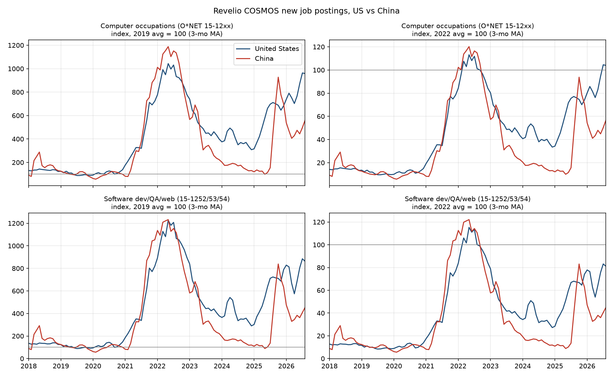
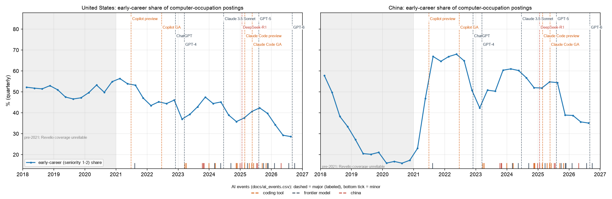
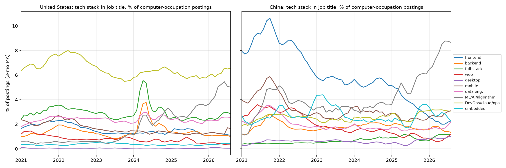
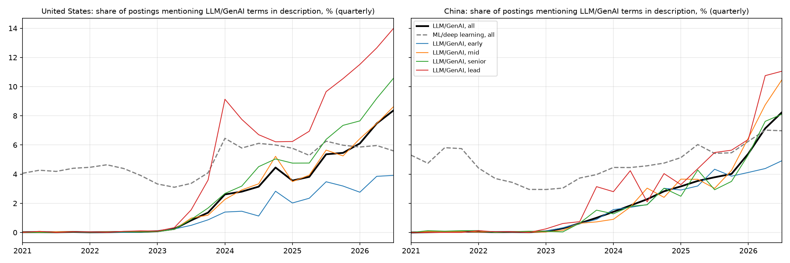
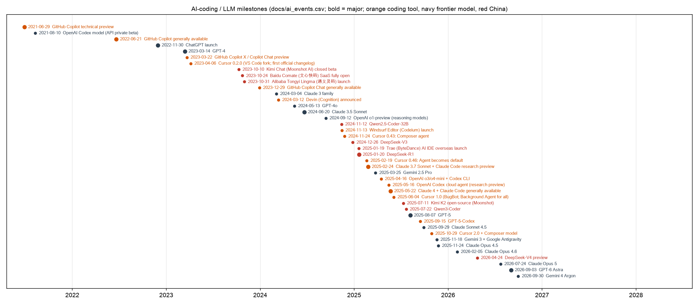
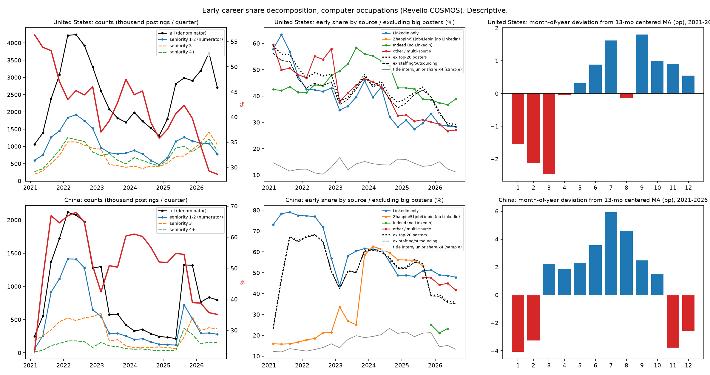
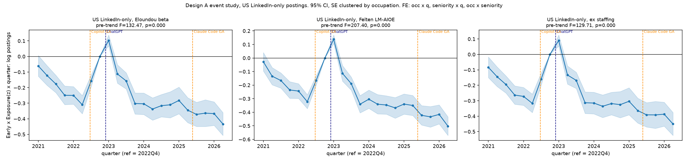
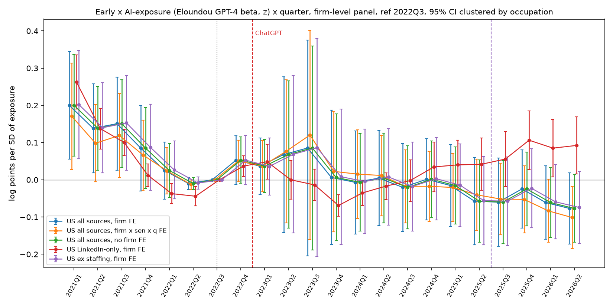
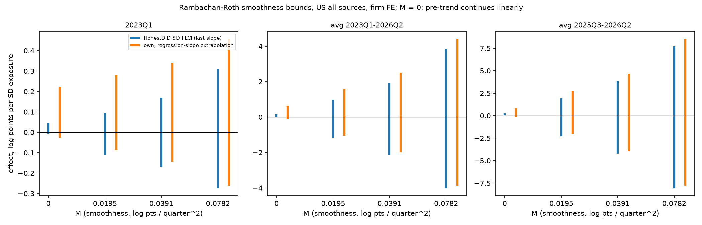
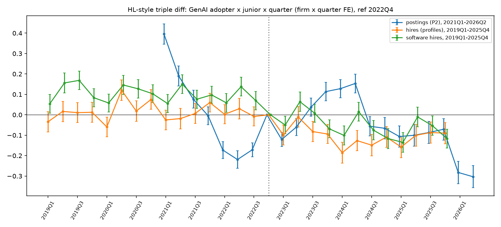

# 生成式 AI 与软件工程初级岗位：基于 Revelio 招聘与履历数据的阶段性报告

> 作者：侯雨昕（Princeton）。版本：2026-10-18。本文所有数值均来自本仓库 `docs/` 下的分析文档与生成表格（`designA_results.md`、`designA_firmFE_results.md`、`rebound_diagnosis.md`、`stack_tags.md`、`data_vs_result_diagnosis.md`、`diag_*.md`）及其对应脚本。图的路径相对于本文件。原始 WRDS 数据仅保存在本地 `data/`，不入库。

---

## 1. 研究问题

本文关注生成式 AI，尤其是 AI 编程工具，对软件工程及其他白领职业劳动力需求的影响，集中考察三个问题：

1. **数量问题。** 2022 年 11 月 ChatGPT 发布之后，软件工程岗位的招聘总量和就业流入是否出现了可归因于 AI 的结构性下降？
2. **资历结构问题。** AI 冲击是否具有"资历偏向"，即初级（early-career）岗位相对资深岗位下降更多？这种相对下降是否随职业的 AI 暴露度递增？
3. **技能结构问题。** 招聘要求中的技术栈与编程语言是否发生了系统性迁移，例如向全栈、AI/ML 方向集中，移动端与桌面端是否收缩？LLM 相关要求的扩散速度如何？

在方法上，本文还回答一个元问题：**如果在某一数据与设计下估计不到显著效应，这是数据本身的局限，还是真实的零效应？**

## 2. 直观感受与初步判断（待检验假设）

在分析之前，公共讨论中流行的叙事可以整理为以下可检验假设：

- **H1（"软件工程已死"）。** ChatGPT 之后，软件工程岗位招聘总量持续、显著下降。
- **H2（初级岗位挤压）。** AI 主要替代初级工作任务，因此初级岗位占比下降，且在 AI 暴露度高的职业中下降更多。这一叙事与 Brynjolfsson, Chandar & Chen 的"矿井中的金丝雀"发现相呼应。
- **H3（全栈化与 AI 化）。** 雇主更倾向于招聘全栈或 AI 方向的工程师，前端、后端等细分岗位和移动端、桌面端岗位收缩。LLM 相关技能要求快速扩散。
- **H4（事件冲击）。** 主要 AI 产品节点会在招聘数据中留下可见的断点，包括 Copilot、ChatGPT、Claude Code 和 2026 年的 OpenClaw 及中国"养龙虾"热潮。
- **H5（中美差异）。** 中国市场受 AI 工具冲击的模式与美国不同。

下文按"描述 → 诊断 → 因果设计 → 设计诊断"的顺序逐层检验这些假设。每一层先给出方法，再给出结果，并说明它为下一层分析提出了什么要求。

## 3. 数据

### 3.1 招聘数据：Revelio COSMOS

**来源与规模。** WRDS 上的 `revelio.postings_cosmos` 是去重后的招聘帖，约 29.2 亿行。字段包括职业代码（O*NET-SOC 2019，8 位）、资历（seniority）、公司（`ultimate_parent_rcid`）、发布日期以及来源标记。来源标记包括 LinkedIn、Indeed、公司官网、Zhaopin、51job、Liepin、聚合网站和外包/派遣公司。全文（标题与职位描述）在 `postings_cosmos_raw` 中，可按 job_id 连接。所有聚合均在 WRDS 服务器端按月完成，本地只保存计数。

**资历定义。** Revelio 的资历是根据职位标题、公司和行业由模型预测的 1–7 级序数变量：

| 代码 | 含义 |
|---|---|
| 1 | 入门 / 实习 |
| 2 | 初级 |
| 3 | 助理 / 分析师 |
| 4 | 经理 |
| 5 | 总监 |
| 6 | 高管 |
| 7 | 高级高管 |

在科技行业，第 4 级多为资深个人贡献者，而非人员管理者。本文定义**初级 = 1–2 级**，**资深 = 3–4 级**，5–7 级不纳入。

**覆盖与来源。**
- **覆盖扩张。** COSMOS 的覆盖在 2021 年急剧扩大，计数增长 4–8 倍，因此 2021 年前的水平不可比；主要分析使用 2021 年及以后的数据。
- **美国来源构成（2024 年 3 月，计算机职业，标记可重叠）。** LinkedIn 74%，公司官网 16%，Indeed 16%，外包公司 8%。
- **中国覆盖。** 仅包括 LinkedIn、Zhaopin、Liepin、51job，不含 Boss 直聘和拉勾。LinkedIn 中国求职应用 InCareer 于 2023-08-09 关停（[LinkedIn Help](https://www.linkedin.com/help/linkedin/answer/a534125)）。国内招聘网站自 2025Q4 起从数据中消失。
- **薪资。** 美国约 85–90%、中国约 55% 的计算机职业薪资为模型预测值。

**本文构建的面板。**

| 面板 | 内容 | 规模 |
|---|---|---|
| P1 | 全部职业，月 × 国家 × O*NET × 资历 × 来源组 × 外包标记，2021-01..2026-09 | 11.0 亿条招聘 |
| P2 | 公司 × 月 × 资历组 × SOC 6 位职业 × 来源组 | 69 个月，420 MB |
| P4 | 美国计算机职业 1/200 抽样，从职位描述解析"要求工作年限" | 29.2 万条 |

P2 的公司样本为基期（2021-01..2022-10）招聘量不少于 50 条的公司：美国 205,387 家，覆盖基期招聘量的 94.2%；中国 61,344 家，覆盖 92.5%。

### 3.2 履历数据：Revelio `individual_positions`

**来源与规模。** 该表来自 LinkedIn 式的个人履历，记录每段任职的起始日期、职业、资历、公司及抽样权重（`weight`，用于校正 LinkedIn 覆盖的职业与地区偏差）。本文把"职位开始"定义为**入职（hire）流量**：美国 2019–2026 年共 1.63 亿条。

**测量问题。**
- **更新滞后。** 个人更新履历存在滞后，最近几个季度被低估：2025Q4 约为 2025Q3 的一半。因此结果分析截至 2025Q4。
- **资历仍为模型预测。** 但履历资历可利用职业经历，理论上比招聘帖标签更稳定。

### 3.3 职业 AI 暴露度（概述）

主度量为 Eloundou et al. 的 β（GPT-4 评分），在职业间标准化后记为 $E_o$。稳健性度量为 Felten 的 AIOE、LM-AIOE 与图像生成 AIOE。Webb 的专利度量没有公开数据，以"时间安慰剂"检验替代。各度量的构造、覆盖率与相关性见 3.4.1。

### 3.4 变量定义与测量

本节给出每个变量的精确构造，均以仓库代码为准，并注明所依据的脚本。凡定义依赖原始论文或数据提供方、无法由本仓库代码直接复核的，单独注明。

#### 3.4.1 AI 暴露度 $E_o$

**Eloundou et al. β**（`tools/build_exposure.py`，数据为 `openai/GPTs-are-GPTs` 的 `occ_level.csv`）。

- **任务层面的标注规则。** 原文以"在质量相当的前提下，LLM 能否把完成某一 O*NET 任务或详细工作活动（DWA）所需时间减少至少 50%"为阈值，把每项任务标为三类：
  - **E0（无暴露）**：时间几乎不减少，或质量下降；
  - **E1（直接暴露）**：仅通过 ChatGPT 或 OpenAI Playground 即可节省至少 50% 的时间；
  - **E2（LLM+ 暴露）**：LLM 本身不足以达到阈值，但在其上开发额外软件即可达到；图像能力原单独标为 E3，分析时并入 E2。
- **三个汇总指标。** $\alpha=E1$（下界），$\beta=E1+0.5\,E2$，$\zeta=E1+E2$（上界）。仓库列名中的 `gamma` 即原文的 $\zeta$。
- **任务→职业聚合。** 有 DWA 标注时，先由 DWA 聚合到任务，再聚合到职业。职业层面以核心任务（core）权重为补充任务（supplemental）的 2 倍，权重和为 1。因此 β 可理解为"职业内被暴露任务的加权比例"，取值范围为 [0, 1]。这一聚合规则引自原文（arXiv 2303.10130，表 2 注释），本仓库直接使用作者发布的职业层面数值，未重新聚合。
- **评分者版本。** 主度量使用 GPT-4 评分版（`dv_rating_beta` → `eloundou_beta_gpt4`），人工评分版（`human_rating_beta`）作稳健性检验。
- **代码层级。** 原始代码为 O*NET-SOC 2019 的 8 位代码，共 923 个。取前 7 个字符（如 `15-1252`）得到 SOC 2018 的 6 位代码，同一 6 位代码内的 8 位值取**不加权**算术平均，得到 798 个 6 位职业。

**Felten, Raj & Seamans AIOE 系列**（同一脚本，数据为 `AIOE-Data/AIOE`）。

- **构造原理。** 依据原文（*SMJ* 2021），以 EFF 的 10 类 AI 应用进展指标为基础，通过众包调查评估每类应用与 52 项 O*NET 能力（abilities）的相关度，得到能力层面的 AI 暴露度。再按各能力在职业中的普遍性与重要性加权，汇总为职业暴露度（AIOE）。这部分构造引自原文，本仓库直接使用作者发布的职业层面数值。
- **两个变体。** LM-AIOE（arXiv 2303.01157）只保留"语言建模"一类应用；图像生成 AIOE 只保留图像生成，作为与编程关联较弱的对照技术。AIOE 本身对应 LLM 之前的 AI 应用。
- **代码转换。** 原始代码为 SOC 2010 的 6 位代码，共 774 个，按以下步骤转换：
  1. 以 6 位代码匹配 O*NET 官方 2010→2019 对照表中的 O*NET-SOC 2010 代码（取前 7 个字符）；
  2. 映射到 O*NET-SOC 2019，再截取为 6 位；
  3. 多对多映射的单元取不加权平均。

  最终得到 802 个 6 位职业。

**标准化与"每标准差"的含义。** 每个度量在**全部有评分的 6 位职业**之间做不加权的 z 标准化：

$$E_o = \frac{e_o - \bar e}{\mathrm{sd}(e)}$$

均值与标准差按职业计算，每个职业权重相同，不按招聘量加权，也不限于回归样本（`add_exposure`）。因此，三重差分系数 $\beta_1$ 的含义是：暴露度高出 1 个职业间标准差，初级相对资深的 $\log(1+y)$ 在事后多变化 $\beta_1$。$100\beta_1$ 近似为对数点；$\beta_1$ 较小时近似为百分比。

**覆盖率与相关性**（`docs/exposure.md`）。
- **覆盖率。** P1（2021-01..2026-09）中，美国 8.506 亿条招聘有 94.6% 落在有 Eloundou 评分的职业（Felten 为 94.8%）；中国 2.472 亿条中为 92.4%。未匹配的主要是"其他"类残差代码（如 35-2019、39-9099、43-9199）和 `unknown`。
- **相关性。** 6 位职业之间，Eloundou β（GPT-4）与人工评分 β 的相关系数为 0.88，与 Felten AIOE 为 0.83，与 LM-AIOE 为 0.81，与图像生成 AIOE 为 0.72。

**分位定义。**
- **四分位（Design A 二元设定）。** 在回归样本中，每个职业计一次、不加权，取 E 的第 25 与第 75 百分位。$E\le P_{25}$ 记为 0，$E\ge P_{75}$ 记为 1，中间职业剔除（`10_designA.py`）。
- **五分位（4.7 功效计算）。** 按 E 排序后，以公司样本的基期招聘量为权重累积，切成五等份。顶端与底端五分位的加权平均 E 之差为 2.76 个标准差（`14_diagnostics.py power`）。

#### 3.4.2 资历与"初级"（Revelio 标签口径）

**Revelio 资历。** 为 1–7 级序数变量，定义见 3.1 的表格。据 Revelio 数据字典，它由基于职位标题、公司、行业的集成模型预测，招聘帖主要依据标题。模型本身为专有，本仓库无法复核其训练与版本更替。

**分组。**
- **初级（Early）** = 1–2 级；**资深（Experienced）** = 3–4 级；5–7 级（总监及以上）不进入三重差分。
- 描述部分另报告"入门占比"（仅 1 级）。
- 技术栈分析使用四组：early = 1–2，mid = 3，senior = 4，lead = 5–7。

**标题关键词校验**（`07_title_kw_pull.py`）。
- **样本。** 计算机职业（O*NET 15-12xx），美国取 `job_id % 50 = 0`，中国取 `job_id % 20 = 0`，时间为 2019-01..2026-09。
- **字段。** 对 `title_raw || jobtitle_translated` 的小写文本按以下顺序匹配，取首个命中：
  - intern_grad：`intern|trainee|graduate|new grad|campus|实习|校招|校园|应届|管培`；
  - junior：`junior|\mjr\M|entry|associate engineer|\m(i|1)\M\s*$|初级|助理`；
  - senior_plus：`senior|\msr\M|staff|principal|\mlead|manager|director|architect|head of|\mvp\M|高级|资深|专家|主管|经理|总监|架构`；
  - 其余记为 none。
- **校验指标。** 各类标题被标为 1–2 级的概率（见 4.7）。

**年限要求校验**（`15_yoe_pull.py`，P4）。
- **样本。** 美国计算机职业招聘中取 `job_id % 200 = 0`，2021-01..2026-09，共 292,346 条。
- **解析。** 在服务器端对小写化的职位描述应用正则：

  `(\d{1,2})\s*\+?\s*(?:(?:-|–|to)\s*\d{1,2}\s*\+?\s*)?(?:years?|yrs?)[^.;\n]{0,40}experience`

  - 取**第一个**匹配的第一个数字 N，即区间的下限；"5+ years" 记为 5。
  - 要求 "years/yrs" 之后 40 个字符内、同一句中出现 "experience"。
  - N > 30 视为缺失。
- **覆盖。** 51% 的帖子解析出 N。
- **已知误差。** 只取首次提及，可能对应"加分项"或某项具体技能的年限，而非岗位总体要求；未覆盖 "experience of 3 years" 一类语序；未处理中文描述。

**衰减因子**（`14_diagnostics.py measure`）。在 1–4 级且解析出 N 的帖子中，以经验口径作参照：
- 灵敏度 $\mathrm{sens}=P(\text{Revelio 初级}\mid N\le 2)=0.61$；
- 特异度 $\mathrm{spec}=P(\text{Revelio 资深}\mid N\ge 3)=0.66$；
- 衰减因子 $\lambda=\mathrm{sens}+\mathrm{spec}-1=0.26$。

当二元分类误差与结果变量无关（非差异性误分类）时，以代理变量计算的组间均值差约为真实差异的 $\lambda$ 倍。注意这里把经验口径视为"真值"，而经验口径本身也有测量误差，因此 0.26 只是对衰减程度的粗略刻画，不是可直接用于校正的精确系数。

#### 3.4.3 经验口径的初级定义

**定义。** $\mathrm{Junior}^{\mathrm{yoe}}=1[N\le 2]$，资深为 $N\ge 3$，解析规则同 3.4.2。

**适用范围。** 该定义只对写明年限的帖子（约 51%）有定义。写明年限的帖子可能与未写明的帖子存在系统差异，例如前者更多来自大公司或标准化模板。本文目前只把它用于描述与效度对照，尚未用作回归结果变量。

#### 3.4.4 职业范围

- **计算机职业**：O*NET 代码前缀 `15-12`，即 SOC 15-12xx，包括软件开发、测试、网络与数据库管理、信息安全及 IT 支持等。描述统计、技术栈标签、标题关键词校验和 P4 均使用这一口径（`01`–`03`、`07`、`15`）。
- **狭义软件**：15-1252（软件开发者）、15-1253（软件质量保证分析与测试）、15-1254（Web 开发者），见 `02_descriptive.py` 的 `NARROW`。
- **Design A 的"软件哑变量"**：15-1251..15-1254，比狭义口径多出 15-1251（计算机程序员）。
- **入职基准中的"软件入职"**：`onet_code like '15-12%'`，实为整个计算机职业（`17_hires_pull.py`）。
- **入职描述图**：只用 15-1252。
- **回归单元**：职业层面一律为 SOC 2018 的 6 位代码，即 `onet_code` 的前 7 个字符。

#### 3.4.5 技术栈、编程语言与 LLM/生成式 AI 标签

**脚本**：`03_stack_language_tags.py`、`docs/stack_tags.md`。

**抽样。** 计算机职业中，美国取 `job_id % 50 = 0`（约 2%），中国取 `job_id % 20 = 0`（约 5%），2021-01..2026-09，共 221 万条。job_id 为不透明哈希标识，因此这是固定的系统抽样，各次运行完全一致。占比无需加权，计数乘以模数可估计总量。

**字段与口径。**
- **技术栈**（这份工作是什么）：取自标题 `title_raw || jobtitle_translated`。
- **语言、框架与 AI 要求**（这份工作要求什么）：取自职位描述，分母为描述长度大于 150 字符的帖子。
- **匹配语法。** 正则为 PostgreSQL ARE。`~*` 不区分大小写；`\m`、`\M` 为词首、词尾边界。

**主要规则（节选）。**
- **全栈**：`full[- ]?stack|全栈`。
- **前端**：`front[- ]?end|\mui (developer|engineer)|前端`。
- **后端**：`(?<!digital )back[- ]?end|server[- ]?side|(?<!数字)后端|后台开发|服务端|服务器端`。排除"数字后端"，即芯片物理设计。
- **移动端**：`\mmobile\M|\mios\M|android|flutter|react native|\mapp (developer|engineer)|移动端|移动开发|安卓|鸿蒙|harmonyos|小程序|\mapp开发`。
- **桌面端**：桌面或 Windows 应用、客户端开发、WPF、Electron、Qt、桌面、客户端、PC端。不含 "desktop engineer"，即 IT 桌面支持。
- **ML/AI 标题**：`machine learning|\mml\M|\mai\M(?!-link)|artificial intelligence|deep learning|\mnlp\M|computer vision|\mllm|genai|generative|算法|大模型|人工智能|机器学习|深度学习|自然语言|计算机视觉|图像识别|aigc`。
- **LLM/生成式 AI（描述）**：`large language model|\mllms?\M|generative ai|\mgen ?ai\M|chatgpt|\mgpt-?[0-9]?\M|langchain|\mrag\M|retrieval[- ]augmented|prompt engineering|\maigc\M|大模型|大语言模型|生成式|提示词`。
- **Kotlin**：`\mkotlin\M`。
- **区分大小写的特殊规则。** Go 与 C 必须出现在语言列表语境中，即逗号、斜杠或括号之间；Swift 须区分大小写，并排除 "SWIFT message/payment" 等金融用法。

**中国页面清洗。** 约 60% 的中国描述（51job、Liepin）是整页抓取。规则为：自"职位信息"处开始保留，截至第一个页脚、链接农场、公司信息或防诈骗提示标记。测试日的效果是链接农场片段从 423/700 降为 0，平均长度从 5,390 字符降至 613 字符。

**精度校验。** 每个标签人工阅读 6–12 条命中样本。Go 修正后 10/10 正确，C 约 9/10。修正记录见 `docs/stack_tags.md`。

**测量含义。** 描述标签度量的是"提及"而非实际使用。长技能列表会一次计入多种语言。Liepin 页面常只有公司介绍，会稀释中国的描述标签。

#### 3.4.6 来源组、外包公司与公司面板

**来源组**（P1，`09_occ_panel_pull.py`）。依据 8 个非 LinkedIn 来源标记，即公司官网、Indeed、Zhaopin、51job、Liepin、其他聚合网站、外包公司、地区聚合网站：
- **li_only**：`source_linkedin` 为真，且 8 个其他标记均为假；
- **li_plus**：LinkedIn 为真，且至少一个其他标记为真；
- **cn_board**：Zhaopin、51job、Liepin 至少一个为真，且 LinkedIn 为假；
- **other**：其余全部。

P2 把 li_plus 并入 other（`12_firm_panel_pull.py`）。"LinkedIn-only" 一律指 li_only。

**外包/派遣标记。**
- **P1**：标记为真的条件是 `source_staffingfirms` 为真，**或**母公司 ID 属于外包名单。
- **外包名单**：母公司名称匹配以下正则、且 2020–2026 年计算机职业招聘不少于 100 条的母公司，共 890 家，名单仅存于 `data/`：

  `staffing|lynx|robert half|allegis|insight global|teksystems|randstad|adecco|manpower|kforce|everforth|recruit|apex systems|kelly services|hays|michael page|cybercoders|chinasoft|farben|法本|中软|wicresoft|archermind|fesco|人力|外包|northking|isoftstone|hirain`

- **P2**："剔除外包"只按该名单剔除公司，因为 P2 未保留来源标记。

**公司样本与单元**（`11`–`13`）。
- 公司 = Revelio `ultimate_parent_rcid`。
- **公司名单**：2021-01..2022-10 期间资历 1–4 级、母公司非空的招聘不少于 50 条的公司。
- **估计单元**：公司 × 职业组合须在基期（2021Q1–2022Q3）每个资历组各有不少于 10 条招聘，不少于 20 条的版本作稳健性检验。在 2021Q1–2026Q2 上补零成平衡面板。

**固定公司-固定来源面板**（`14_diagnostics.py panel`）。在 2021Q1–2026Q2 全部 22 个季度中，每季度都有不少于 1 条 li_only 招聘（任意职业）的公司，共 17,307 家。再施加上述单元门槛后，估计样本为 11,029 家公司、89,926 个公司-职业组合。

#### 3.4.7 基准复现中的 AI 采用公司

**本文定义**（`16_genai_adopters_pull.py`）。
- 美国招聘中，Revelio 职位分类 `role_k17000_v3` 取值为 "Generative AI Engineer" 或 "Conversational AI Engineer" 的帖子，按母公司汇总。
- **采用季度**：首次出现此类帖子的季度。
- **采用公司**：采用季度在 2023Q1–2025Q1 之间，且属于 P2 公司名单，共 1,066 家。
- 2023 年前已有此类帖子的 495 家公司被剔除。
- **对照组**：其余 P2 公司。

**与 HL 定义的差别。**
- **识别方法。** Hosseini Maasoum & Lichtinger 先以生成式 AI 关键词标记招聘帖，再用 LLM 判断是否为真正的"生成式 AI 集成者"岗位，截至 2025 年 3 月识别出 10,599 家采用公司（约 28.5 万家公司中的 3.7%）。本文口径窄得多。
- **事件前即有此类岗位。** 此类角色在 2021–2022 年已有 1,448 和 2,600 条，说明 Revelio 的这一分类在 LLM 之前也收录了对话式或 NLP 类岗位。

#### 3.4.8 入职（hires）

**来源**：`17_hires_pull.py`，`revelio.individual_positions`。

**定义。**
- 一次"入职"指一条任职记录，其 `startdate` 落在季度 $t$（或月份）内，且 `country = 'United States'`。
- 公司为记录的 `ultimate_parent_rcid`；职业为记录的 `onet_code`（截取为 6 位）。
- 资历为 Revelio 对该任职记录预测的资历。理论上可利用履历信息，但同样为专有模型。
- 计数使用 Revelio 抽样权重 `weight` 加总（"加权入职"），用以校正 LinkedIn 在职业与地区上的覆盖偏差。

**无法由代码确认的定义。** 同一公司内的晋升或换岗是否生成新的任职记录，取决于 Revelio 的履历切分规则。本文未区分外部入职与内部变动，这一点无法由本仓库代码确认。

**滞后。** 履历更新存在滞后，加权入职总量在 2025Q4 为 240 万，而 2025Q3 为 433 万。因此入职分析截至 2025Q4，并应视最近几个季度为下限。

**首份工作代理。**
- **定义**：`first_job = 1[position_number = 1]`，即履历中的第一段任职。
- **问题**：它包括实习、兼职与学生工作，且依赖个人填写的完整性，因此只是"22–25 岁"的弱代理。

**样本门槛。** 职业层面要求基期每组加权入职不少于 200。

#### 3.4.9 时间、事件与季节调整

**时间口径。** 季度为日历季度（Q1 为 1–3 月），月份按 `post_date` 或 `startdate` 归属。招聘数据最后一个完整季度为 2026Q2，因为 2026-09 只到 9 月 6 日。

**事件变量。**
- $\mathrm{Post}_t=1[t\ge 2023Q1]$。ChatGPT 发布于 2022-11-30，2022Q4 仅 1 个月受影响，作为过渡期。
- $\mathrm{Post2}_t=1[t\ge 2025Q3]$。Claude Code GA 于 2025-05-22，2025Q3 为其后第一个完整季度；Post2 是叠加在 Post 之上的增量。
- 事件日期与来源链接见 `docs/ai_events.csv`。

**基期与参照季度。**

| 分析 | 基期 | 参照季度 |
|---|---|---|
| Design A（职业层面） | 2021Q1–2022Q3 | 2022Q4 |
| 公司 FE 与入职职业层面 | 2021Q1–2022Q3（入职从 2019Q1 起） | 2022Q3 |
| 采用公司基准 | — | 2022Q4 |

**结果变量。**
- 单元计数 $n$ 取 $\log(1+n)$，平衡面板中缺失补零。
- 同比口径为同一单元的 4 季度对数差 $\log(1+n_t)-\log(1+n_{t-4})$。

**季节调整**（`08_rebound_diagnosis.py`，仅用于描述性的初级占比月度序列）。
1. 以 13 个月中心移动平均作为趋势；
2. 计算各月偏离趋势的值；
3. 按月份（1–12 月）对 2021–2026 年的偏离取平均，得到月份效应；
4. 季节调整序列 = 原序列 − 对应月份效应。

同比 = 当月占比 − 12 个月前占比。

#### 3.4.10 测量汇总表

| 变量 | 定义 | 来源 | 已知效度问题 |
|---|---|---|---|
| $E_o$（主） | Eloundou β = E1 + 0.5·E2（GPT-4 评分）；核心任务权重为补充任务的 2 倍；8 位 → 6 位不加权平均；职业间不加权 z 标准化 | GPTs-are-GPTs `occ_level.csv` | 衡量潜在暴露而非实际采用；与其他白领度量相关 0.72–0.88，难以区分 LLM 与一般白领冲击 |
| Felten AIOE / LM-AIOE / 图像 AIOE | 能力-应用关联加权；SOC 2010 → 2019 官方对照，多对多平均；z 标准化 | AIOE-Data | 能力层面较粗；前 LLM 时代的 AIOE 给出相同结果，安慰剂含义有限 |
| 初级 / 资深（标签） | Revelio 资历 1–2 / 3–4 | `postings_cosmos.seniority`；`individual_positions.seniority` | 专有模型；对经验口径的衰减因子为 0.26；标签随时间漂移；2023 年 1–2 月 3 级尖峰；中国网站 2023 年重编码 |
| 初级（经验口径） | 描述中首个"N years … experience"的 N ≤ 2 | `postings_cosmos_raw.description`，1/200 抽样 | 仅 51% 有定义；首次提及偏误；未覆盖中文与其他语序 |
| 计算机职业 / 狭义软件 | 15-12xx / 15-1252、15-1253、15-1254（软件哑变量为 15-1251..54） | `onet_code` | IT 支持等也在 15-12xx 内；职业由 Revelio 从标题映射 |
| 技术栈 / 语言 / LLM 标签 | 标题或描述正则（见 3.4.5）；美国 1/50、中国 1/20 抽样 | `postings_cosmos_raw` | 度量"提及"；精度经小样本人工校验；中国页面需清洗；美国标题多为泛化名称 |
| 来源组 | li_only / li_plus / cn_board / other（标记组合） | `source_*` 标记 | LinkedIn-only 占比在 0.07–0.45 间大幅变动；LinkedIn 中国 2023-08 退出；国内网站 2025Q4 消失 |
| 外包标记 | `source_staffingfirms` 或名称正则命中的 890 家母公司 | 标记与母公司名称 | 正则可能漏检或误检；P2 中只按名单剔除 |
| 公司 | `ultimate_parent_rcid`，基期不少于 50 条招聘 | Revelio 公司映射 | 65–77% 的中国帖子没有母公司 ID |
| 固定面板 | 22 个季度每季度都有 li_only 招聘的公司 | P2 | 偏向大型、稳定雇主 |
| AI 采用公司 | 首个 "Generative / Conversational AI Engineer" 帖子在 2023Q1–2025Q1 | `role_k17000_v3` | 口径远窄于 HL（1,066 对 10,599）；该分类在 LLM 之前已有岗位 |
| 入职 | `startdate` 在 $t$ 的任职记录，以 `weight` 加总 | `individual_positions` | 履历更新滞后，2025Q4 约为前一季度一半；内部变动未区分；资历为模型预测 |
| 首份工作 | `position_number = 1` | `individual_positions` | 混入实习与学生工作，是年龄的弱代理 |
| Post / Post2 | 2023Q1+ / 2025Q3+ | `docs/ai_events.csv` | 与 2022–23 年利率上升、科技收缩、Section 174 时间重合 |
| 季节调整 | 13 个月中心移动平均的月份偏离均值 | 08 | 中国的月份效应跨越来源断点估计，仅作参考 |

## 4. 方法与结果

### 4.1 描述性趋势：招聘量、资历结构与初级占比

**方法。** 对计算机职业（O*NET 15-12xx）按月汇总招聘量与资历分布，计算初级（1–2 级）占比。中美分开计算。

**结果。** 年度月均值见下表（"计算机职业占比"指占全部招聘的比例）。2026 年仅含 1–9 月。

| 年份 | 美国月均招聘 | 美国计算机职业占比 | 美国初级占比 | 中国月均招聘 | 中国初级占比 |
|---|---|---|---|---|---|
| 2021 | 658.7k | 7.75% | 52.8% | 324.3k | 50.2% |
| 2022 | 1,307.5k | 9.30% | 44.8% | 620.3k | 62.4% |
| 2023 | 683.8k | 6.45% | 41.6% | 239.9k | 50.7% |
| 2024 | 546.5k | 5.63% | 41.3% | 101.3k | 57.4% |
| 2025 | 874.8k | 5.35% | 40.0% | 257.5k | 49.8% |
| 2026 | 1,202.0k | 6.93% | 31.0% | 299.4k | 36.6% |

**对假设的含义。**
- **H1。** 美国招聘量在 2022 年见顶，2023–24 年大幅回落，2025–26 年又回升。计数受覆盖与来源变化的强烈影响，不能直接支持持续性的"消亡"。
- **H2。** 美国初级占比从 2021 年的 52.8% 降至 2026 年的 31.0%，方向符合初级挤压假设。但其中 2023 年出现了显著的反弹（见 4.4）。

**引出的问题。** 初级占比的长期下降究竟是需求变化，还是来源构成与资历模型变化？反弹从何而来？这需要标签层面的诊断（4.4）和职业间对照（4.5）。

### 4.2 技术栈、编程语言与 LLM 提及

**方法。**
- **抽样。** 美国按 job_id 取 1/50，中国取 1/20，共 221 万条招聘。
- **打标。** 在服务器端对标题打技术栈标签，对职位描述打语言、框架与 AI 标签（正则匹配，中英文关键词）。
- **校验。** 每个标签人工阅读 6–12 条命中样本校验精度，并修正误匹配，例如 "go to office"、IT 桌面支持类的 "Desktop Engineer"、芯片"数字后端"。
- **中国文本清洗。** 约 60% 的中国职位描述是整页抓取，只保留"职位信息"段落。

**结果（美国，招聘中提及比例，%；2021 → 2026）。**

| 指标 | 2021 | 2023 | 2024 | 2025 | 2026 |
|---|---|---|---|---|---|
| LLM/生成式 AI 术语（描述） | 0.03 | 0.56 | 3.15 | 4.68 | 7.27 |
| ML/AI 标题 | 0.53 | 0.71 | 2.51 | 3.07 | 4.91 |
| 全栈标题 | 3.21 | 2.64 | 3.86 | 2.44 | 2.74 |
| 前端标题 | 2.14 | 1.26 | 1.30 | 1.41 | 1.11 |
| 移动端标题 | 2.31 | 1.46 | 1.37 | 1.22 | 1.43 |
| Python | 16.17 | 15.36 | 20.88 | 18.33 | 19.19 |
| JavaScript | 17.37 | 13.56 | 15.20 | 15.46 | 12.43 |
| Kotlin | 1.15 | 0.76 | 0.87 | 0.85 | 0.84 |
| Swift | 1.18 | 0.79 | 0.91 | 0.93 | 0.72 |

**中国（2021 → 2026）。**
- LLM 术语 0.05% → 6.95%；ML/AI 标题 4.32% → 8.27%。
- 移动端标题 5.15% → 2.85%；前端标题 9.59% → 2.17%。
- 全栈标题 0.43% → 1.11%；桌面端标题 0.63% → 0.93%；Kotlin 0.37% → 0.66%。

**对假设的含义（H3）。** LLM 要求和 AI 方向岗位的扩散是本数据中最清晰、最稳健的变化。美国的"全栈化"不明显：全栈标题占比在 2.4%–3.9% 之间波动，没有趋势。但美国全栈岗位内部的初级占比从 64.95% 降至 31.78%。移动端与前端收缩，在中国尤为显著。

**测量说明。**
- 描述标签度量的是"招聘要求的提及"，而不是实际使用的工具。
- 美国多数标题是泛化的 "Software Engineer"，因此标题栈占比宜作相对趋势解读。
- 美国 2023Q4–2024Q2 有一个疑似由大型发帖方或来源批次造成的尖峰。

### 4.3 AI 事件时间线叠加

**方法。**
- **事件表。** 整理 47 个有来源链接的事件（`docs/ai_events.csv`），包括 Copilot 预览（2021-06-29）与 GA（2022-06-21）、ChatGPT（2022-11-30）、GPT-4、Claude 3.5 Sonnet、DeepSeek-R1、Claude Code 预览（2025-02-24）与 GA（2025-05-22）、GPT-5，以及 OpenClaw 系列事件：
  - 2025-11-24 Warelay/Clawd 首发；
  - 2026-01-27 更名 Moltbot；
  - 2026-01-30 更名 OpenClaw 并达到传播高峰（GitHub 10 万+ star，周访问 200 万）；
  - 2026-02-15 作者 Steinberger 加入 OpenAI；
  - 2026-03-09 中国"养龙虾"热潮（腾讯 WorkBuddy/QClaw、字节 ArkClaw 等）。
- **叠加与比较。** 把事件叠加在季度序列上，并计算事件前后各 4 个季度的均值差。这是纯描述，没有对照组。

**结果（事件前后 4 季度均值差，百分点）。**

| 事件 | 美国初级占比 | 中国初级占比 | 美国 LLM 术语 | 中国 LLM 术语 |
|---|---|---|---|---|
| Copilot GA（2022-06） | −7.73 | −9.11 | +0.08 | +0.06 |
| ChatGPT（2022-11） | −3.40 | −15.12 | +0.60 | +0.46 |
| Claude Code GA（2025-05） | −2.96 | −13.27 | +2.61 | +2.56 |

**对假设的含义（H4）。** LLM 术语在事件后迅速上升，事件与技能要求的关联清晰。初级占比在多个事件前后都在下降，但下降早于 ChatGPT，而且 Copilot GA 前后的降幅最大。这说明简单的前后比较无法把 AI 事件与已有趋势分开。中国的变化幅度很大，但与来源断点重合（见 4.4）。

**引出的问题。** 需要识别 2023 年反弹的来源，并引入对照组以去除共同冲击。

### 4.4 2023 年反弹与季节性诊断

**方法。**
- 分解初级占比的分子（1–2 级计数）与分母（全部计数）；
- 按来源做 shift-share 分解；
- 剔除前 20 大母公司、外包公司和无母公司 ID 的帖子；
- 用标题关键词检验资历模型；
- 估计 13 个月中心移动平均下的月度季节效应。

**结果：美国。**
- **反弹是分母效应。** 初级占比从 2023Q1 的 37.0% 升至 2023Q4 的 47.5%，但同期初级招聘计数**下降** 17%（966k → 806k），3 级下降 57%（916k → 396k）。
- **不是来源结构。** shift-share 分解中，组间贡献 +0.7 个百分点，组内贡献 +9.9 个百分点。
- **不是大型发帖方。** 剔除前 20 大母公司后为 38.2% → 48.1%。
- **不是季节性。** 季节调整后仍上升约 9 个百分点；2023 年 9–12 月的同比变化约为 0。
- **2023 年 1–2 月的异常。** LinkedIn 上出现 3 级帖子的尖峰，3 级与 1–2 级之比为 1.2–1.3，而前后月份为 0.6–0.8。

**结果：中国。** 2023 年反弹（42.3% → 60.4%）主要是测量伪迹：
- Zhaopin 的初级占比在一个月内从 15.5%（2023-09）跳到 58%（2023-10）；
- Liepin 在 2023Q4 从 21% 跳到 54%；
- 51job 在 2022-12/2023-01 从 36% 跳到 68%；
- 叠加 LinkedIn 中国的退出与国内招聘网站的进出。

**季节性。** 美国 1–3 月偏低，振幅约 4 个百分点；中国 11 月至次年 2 月偏低、7–8 月偏高，振幅约 10 个百分点。

**引出的问题。**
1. 必须使用计数而不仅是占比，并采用同比或季节调整。
2. 因果设计不能以 2022Q4/2023Q1 为基期。
3. 中国序列不能跨越来源断点直接比较，只能作描述。

### 4.5 职业暴露度三重差分与事件研究（Design A，职业层面）

**方法。** 以"SOC 6 位职业 $o$ × 资历组 $s$ × 季度 $t$"为单元。主样本为美国 LinkedIn-only 招聘，即仅在 LinkedIn 出现、不带其他来源标记的帖子，约占美国招聘的 28.7%，是时间上最稳定的来源。时间为 2021Q1–2026Q2。纳入基期每个资历组不少于 50 条招聘的职业，共 729 个职业、32,076 个单元、2.226 亿条招聘。主设定为

$$
\log(1+y_{ost}) = \beta_1\,\mathrm{Early}_s E_o \mathrm{Post}_t + \beta_2\,\mathrm{Early}_s E_o \mathrm{Post2}_t + \alpha_{ot} + \gamma_{st} + \delta_{os} + \varepsilon_{ost},
$$

其中：
- $E_o$ 为职业间不加权 z 标准化的 Eloundou β（3.4.1）；$\mathrm{Early}_s$ 为 Revelio 资历 1–2 级的指示变量，对照组为 3–4 级（3.4.2）；
- $\mathrm{Post}_t = 1[t \ge 2023Q1]$（ChatGPT）；
- $\mathrm{Post2}_t = 1[t \ge 2025Q3]$（Claude Code GA 后的"智能体编程"阶段，是在 Post 之上的增量）；
- 标准误按职业聚类。

$\beta_1<0$ 表示 ChatGPT 之后，暴露度每高 1 个标准差，初级相对资深的招聘多下降 $100\beta_1$ 个对数点。事件研究把交互项替换为各季度哑变量 $\sum_{k\neq \text{ref}} \theta_k \mathrm{Early}_s E_o 1[t=k]$，基期为 2022Q4。

**结果。**

| 设定 | Early×E×Post | Early×E×Post2 |
|---|---|---|
| 主设定（Eloundou β） | −0.070*** (0.017) | −0.148*** (0.021) |
| Felten LM-AIOE | −0.093*** (0.018) | −0.188*** (0.022) |
| 剔除外包公司 | −0.069*** (0.018) | −0.156*** (0.021) |
| **加入差异化线性趋势** | **+0.152*** (0.024)** | +0.025 (0.026) |
| **同比对数变化** | −0.027 (0.021) | −0.017 (0.027) |
| **时间安慰剂（虚构事件 2022Q1）** | **−0.087*** (0.018)** | — |
| 美国全部来源合并 | +0.041*** (0.012) | −0.241*** (0.023) |
| 软件开发者（15-1251..54）哑变量 | −0.193 (0.135) | −0.189*** (0.050) |

**事件研究。** 7 个前期系数的联合 Wald 检验 F = 132.5，p < 0.001。前期系数自 2021Q1 起单调下降：−0.061、−0.123、−0.177、−0.249、−0.250、−0.310（2022Q2）。

**解读。** 暴露度越高的职业，初级招聘下降越多。但这一梯度在 ChatGPT **之前**已经形成：
1. 时间安慰剂系数与真实系数相当；
2. 控制线性趋势后，效应变号；
3. 同比口径下效应为零；
4. 合并全部来源后，效应符号翻转。

此外，Felten 的前 LLM 时代 AIOE 和图像生成 AIOE 给出相同答案。这说明暴露度度量捕捉的是更一般的"白领初级"冲击，例如 2022–23 年科技行业收缩和利率敏感性。

**引出的问题。** 需要用公司 × 时间固定效应吸收雇主层面的冲击，并对前趋势做稳健推断。

### 4.6 公司固定效应与 HonestDiD

**方法。** 使用 P2 面板，单元为"公司 $f$ × 职业 $o$ × 资历组 $s$ × 季度 $t$"。纳入基期每个资历组不少于 10 条招聘的公司-职业组合，补零成平衡面板。美国全部来源样本为 54,699 家公司、254,652 个公司-职业组合、1,120 万个单元、3.21 亿条招聘。主设定为

$$
\log(1+y_{fost}) = \beta_1\,\mathrm{Early}_s E_o \mathrm{Post}_t + \beta_2\,\mathrm{Early}_s E_o \mathrm{Post2}_t + \lambda_{ft} + \alpha_{ot} + \delta_{os} + \gamma_{st} + \varepsilon_{fost}.
$$

在平衡面板中，每个公司-职业-季度同时含有两个资历单元，因此公司×季度固定效应 $\lambda_{ft}$ 与三重交互项正交，不会改变估计。实质性的公司内控制是**公司×资历×季度**固定效应 $\lambda_{fst}$：它吸收公司整体的初级/资深结构变化，例如全公司冻结校招。

事件研究的基期改为 2022Q3，以避开 2023 年初的标签尖峰。前趋势的稳健推断采用 Rambachan & Roth (2023) 的方法，考虑两类约束：

$$
\Delta^{SD}(M)=\{\delta: |(\delta_{t+1}-\delta_t)-(\delta_t-\delta_{t-1})|\le M\},\qquad
\Delta^{RM}(\bar M)=\{\delta: |\delta_{t+1}-\delta_t|\le \bar M\cdot \max_{s<0}|\delta_{s+1}-\delta_s|\}.
$$

- $M=0$ 表示前趋势严格线性延续；
- $\bar M$ 表示事后偏离相对于事前最大偏离的倍数。

计算使用 Python 版 `honestdid` 0.1.1，在本地修补了与 numpy 2 不兼容的问题，并用自写的闭式识别集交叉核对。

**结果：点估计。**

| 设定 | Post | Post2 |
|---|---|---|
| 主设定（$\lambda_{ft}$） | −0.070* (0.037) | −0.066*** (0.025) |
| 同一样本、无公司 FE | −0.070** (0.035) | −0.066*** (0.024) |
| 公司×资历×季度 FE | −0.046 (0.033) | −0.091*** (0.027) |
| LinkedIn-only | −0.056** (0.023) | **+0.082*** (0.018)** |
| 剔除外包公司 | −0.070* (0.037) | −0.065** (0.026) |
| 同比口径 | +0.111* (0.063) | −0.017 (0.024) |
| 时间安慰剂（2022Q1） | **−0.139*** (0.052)** | — |

**结果：前趋势。** 前期系数从 2021Q1 的 +0.20 (0.07) 单调降至 2022Q2 的 −0.01。联合检验 χ²(6) = 151.5；公司×资历×季度 FE 下为 69.2；LinkedIn-only 为 80.6。

**结果：稳健区间（95%，主设定）。**

| 目标参数 | 原始区间 | SD, M=0 | SD, M=0.02 | RM, M̄=0.25 |
|---|---|---|---|---|
| 2023Q1 | [−0.039, 0.112] | [−0.006, 0.048] | [−0.109, 0.095] | [−0.065, 0.156] |
| 2023Q1–2026Q2 均值 | [−0.142, 0.125] | [−0.009, 0.154] | [−1.19, 0.98] | [−0.25, 0.34] |
| 2025Q3–2026Q2 均值 | [−0.159, 0.048] | [+0.031, 0.248] | [−2.30, 1.92] | [−0.35, 0.39] |

**解读。**
- **只有 M=0 时区间才排除 0，而且符号取决于外推所用的斜率。** 公司×资历×季度 FE 下，2025Q3–2026Q2 均值在 M=0 时为 [−0.338, −0.145]，与主设定方向相反。
- **前趋势明显非线性**（2021 年陡降、2022 年走平），因此 M=0 不可信。
- **结论。** 加入公司固定效应不改变职业层面的结论：招聘帖数据中没有识别出的 AI 效应。

**引出的问题。** 零效应究竟来自数据还是真实世界？这需要进行功效、测量和覆盖诊断，并做已知结果的复现。

### 4.7 数据局限还是真实结果：设计诊断

**（1）功效与最小可检测效应（MDE）。** 以 $\mathrm{MDE}=2.80\times \mathrm{SE}$（80% 功效、5% 双侧）计算。顶端与底端五分位职业之间的暴露度差为 2.76 个标准差。把文献效应换算到"每标准差暴露度"的单位：
- Brynjolfsson et al. 的 13% 约为 −0.050；
- Hosseini Maasoum & Lichtinger 的 7.7%–10% 约为 −0.029 至 −0.038。

本文各设定的 MDE：

| 设定 | MDE |
|---|---|
| 职业层面 | 0.048 |
| 公司 FE | 0.104 |
| 公司×资历×季度 FE | 0.092 |
| 公司层面 LinkedIn-only | 0.064 |

**判断：数据局限。**
- 在不考虑前趋势时，MDE 已达文献效应的 1–3 倍。
- 招聘帖的前趋势斜率为每季度 −0.037，约为文献隐含斜率（−0.005）的 7 倍。
- 考虑前趋势后，稳健区间的半宽为 0.08（M=0）至 1.09（M=0.25×观测曲率），是文献效应的 2–20 倍。

**（2）资历测量效度。** P4 从职位描述中解析"要求 N 年经验"（解析规则、样本与衰减因子的计算见 3.4.2–3.4.3），51% 的帖子写明年限。

| Revelio 资历 | 要求年限中位数 | 要求 ≤2 年占比 | 要求 ≥5 年占比 |
|---|---|---|---|
| 1 | 2 | 0.50 | 0.24 |
| 2 | 4 | 0.23 | 0.49 |
| 3 | 5 | 0.14 | 0.60 |
| 4 | 5 | 0.08 | 0.70 |

- **一致性弱。** P(标签初级 \| 要求 ≤2 年) = 0.61，P(标签资深 \| 要求 ≥3 年) = 0.66，误分类衰减因子（灵敏度 + 特异度 − 1）为 **0.26**。
- **水平漂移。** Revelio 初级占比从 0.53 降至 0.26，而"要求 ≤2 年"的占比仅从 0.20 降至 0.16。2021–22 年标签下降在年限要求上没有对应变化，两者季度变化的相关系数为 0.04。
- **标签含义随时间漂移。** 带 senior 字样的标题被标为初级的比例从 0.28（2021Q1）降到 0.15（2022），再降到 0.02（2026Q2）。
- **判断：数据局限。** 招聘帖资历是有噪声且非平稳的代理变量，可以解释部分"前趋势"。

**（3）来源构成与固定面板。**
- **来源结构剧烈波动。** 美国 LinkedIn-only 占比为 0.13（2021Q1）→ 0.45（2022Q1）→ 0.07（2025Q3 起）。
- **固定面板。** 11,029 家每个季度都在 LinkedIn 发帖的公司：只用其 LinkedIn 帖时 Post2 = +0.070 (0.018)，使用其全部来源时 Post2 = −0.113 (0.029)。
- **判断。** Post2 的符号翻转是覆盖伪迹。前趋势在固定公司与来源后依然存在（χ² ≈ 100–150），并非公司进出所致。

**（4）基准复现。** 仿照 Hosseini Maasoum & Lichtinger 的设计。以 Revelio 职位分类中的 "Generative AI Engineer / Conversational AI Engineer" 识别 1,066 家 2023Q1–2025Q1 的生成式 AI 采用公司（口径明显窄于原文，定义见 3.4.7）；结果变量分别为 P2 招聘帖和加权入职（3.4.8）。设定为

$$
\log(1+y_{fst}) = \beta\, A_f \mathrm{Junior}_s \mathrm{Post}_t + \lambda_{ft} + \mu_{fs} + \gamma_{st} + \varepsilon_{fst},
$$

标准误按公司聚类。

| 结果变量 | 初级 DiD | 资深 DiD | 三重差分 β |
|---|---|---|---|
| 入职（履历，加权），2019Q1–2025Q4 | −0.104*** (0.016) | +0.016 (0.015) | **−0.120*** (0.011)** |
| 入职，截至 2024Q2 | −0.069*** (0.015) | +0.044*** (0.014) | −0.113*** (0.011) |
| 软件岗位入职 | −0.154*** (0.014) | −0.004 (0.012) | −0.150*** (0.011) |
| 招聘帖，截至 2024Q2 | +0.490*** (0.035) | +0.460*** (0.035) | +0.030** (0.015) |

- **入职。** 事件研究前期在 ±0.06 以内，2023Q3 起降至 −0.10 至 −0.18，与原文的量级和时点一致。
- **招聘帖。** 前趋势检验 χ²(7) = 773，事后路径剧烈波动。
- **判断。** 同一数据源能够复现已发表的模式，失败的是"招聘帖"这一结果变量。

**（5）以入职作为结果变量（职业层面）。** 沿用 4.5 的三重差分，结果变量换成加权入职数（定义与滞后问题见 3.4.8）。样本为 660 个职业，2019Q1–2025Q4。

| 设定 | Post | Post2 | 同比 Post | 前期 χ² (p) |
|---|---|---|---|---|
| 初级 = 资历 1–2 | **−0.073*** (0.009)** | −0.057*** (0.011) | −0.051*** (0.007) | 35.9 (0.001) |
| 首份工作 vs 其他入职 | −0.009 (0.006) | −0.015* (0.008) | −0.012*** (0.004) | 51.8 (<0.001) |

- **前期系数。** 2019Q1–2022Q2 均在 ±0.035 以内且无趋势。联合检验拒绝原假设，源于标准误很小，而非漂移。
- **事后系数。** 2023Q2 前在 0 附近，此后为 −0.05（2024Q1）、−0.10（2025Q1）、−0.14（2025Q3）。
- **稳健区间。**
  - M=0 时，2024Q1 为 [−0.076, −0.034]，2023Q1–2025Q4 均值为 [−0.103, −0.065]，均排除 0。
  - 相对幅度约束的临界值 $\bar M \approx 0.2$–0.3：只要事后偏离不超过事前最大季度波动的约四分之一，效应依然成立。该最大波动包括 COVID 季度。
- **首份工作指标。** 作为 22–25 岁的代理较弱，因为 position_number = 1 混入了实习。
- **描述性证据。** 软件开发者（15-1252）的首份工作入职从 100（2022Q3）降至约 30–50，其他入职降至约 80。

## 5. 总结

### 5.1 可以主张的结论

1. **技能要求变化真实且迅速。** LLM/生成式 AI 要求在美国计算机职业招聘中从 0.03%（2021）升至 7.27%（2026），中国从 0.05% 升至 6.95%。AI/ML 方向的标题显著增加。
2. **招聘帖层面没有可识别的 AI 效应，但这一零结果没有信息量。** 原因有四：
   - 功效不足，MDE 不小于文献效应；
   - 资历标签的衰减因子约为 0.26，且随时间漂移；
   - 来源构成剧烈变化，导致符号翻转；
   - 2021–22 年存在强前趋势，HonestDiD 区间在任何合理的 M 下都包含 0。
3. **履历入职数据显示资历偏向的下降。** 2023 年下半年起，入职数据中出现按暴露度分级的初级下降：每标准差暴露度约 −0.07 对数点，到 2025Q3 约为 −0.14。前趋势平坦，且同一数据复现了 Hosseini Maasoum & Lichtinger 的采用公司结果（−0.12）。量级与 Brynjolfsson et al. 及 Hosseini Maasoum & Lichtinger 一致。

### 5.2 不能主张的结论

- **H1 不成立或无法判断。** 招聘总量受覆盖与来源变化主导，"软件工程消亡"的叙事得不到支持。
- **入职结果仍是相关性证据。** 它依赖 Revelio 的履历资历推断和履历更新行为，也尚未排除 2023 年其他按暴露度分级、偏向初级的冲击，例如利率上升和美国税法 Section 174 研发费用资本化摊销对科技行业的影响。
- **中国结果只能作描述。** 资历重编码（2023-01、2023-10）和来源进出（2023-08、2025Q4）使任何跨期比较都不可靠。
- **H3 中"全栈化"在美国不成立。** 全栈标题占比无趋势，仅全栈岗位内部的初级占比下降。

### 5.3 局限

- 招聘帖不等于需求，存在重复发布和"幽灵岗位"。
- 履历存在自选择和更新滞后。
- 资历是模型预测变量。
- 暴露度度量对白领认知型职业有共同排序（相关 0.72–0.88），难以区分 LLM 与其他白领冲击。
- 生成式 AI 采用公司的识别口径窄于原文（1,066 家对 10,599 家）。

### 5.4 下一步

1. **以入职为主要结果变量。** 在公司×资历×季度固定效应下估计职业暴露度设计，并对履历更新滞后做敏感性分析，例如按数据快照截断。
2. **基于经验年限的初级定义。** 扩大 P4 抽样，把"要求 ≤2 年"作为招聘端的替代初级定义，并用于主回归。
3. **固定来源面板。** 招聘帖分析只在固定来源、固定公司面板中进行，并加入来源×资历×时间固定效应。
4. **竞争性解释检验。** 利用研发强度、利率敏感性和受 Section 174 影响的行业差异做安慰剂与异质性检验；在白领职业内部比较高、低 LLM 暴露度。
5. **公司 AI 采用度量（P3）。** 从职位描述中构建公司层面的 AI 工具提及度（Copilot、Cursor、Claude Code 等），并经人工校验精度与召回，用于交错采用的事件研究（Callaway–Sant'Anna / Sun–Abraham）。设计草稿见 `docs/p3_firm_ai_adoption_sketch.md`。

---

## 参考文献（含发表状态）

- Brynjolfsson, E., Chandar, B., & Chen, R. "Canaries in the Coal Mine? Six Facts about the Recent Employment Effects of Artificial Intelligence." Stanford Digital Economy Lab / SIEPR 工作论文，2025 年 8 月，2026 年 8 月更新。**未经同行评审。** [SIEPR](https://siepr.stanford.edu/publications/working-paper/canaries-coal-mine-six-facts-about-recent-employment-effects-artificial)；[2026 更新版 PDF](https://digitaleconomy.stanford.edu/app/uploads/2026/08/Canaries_August2026.pdf)
- Hosseini Maasoum, S. M., & Lichtinger, G. "Generative AI as Seniority-Biased Technological Change: Evidence from U.S. Résumé and Job Posting Data." SSRN 5425555，2025。**工作论文。** [SSRN](https://papers.ssrn.com/sol3/papers.cfm?abstract_id=5425555)
- Westby, Modestino & Cheng. "Generative AI and the Redefinition of Entry-Level Software Work." IZA DP 18723，2026。**工作论文。** [IZA](https://docs.iza.org/dp18723.pdf)
- Humlum, A., & Vestergaard, E. "Large Language Models, Small Labor Market Effects." NBER w33777。**工作论文。** [NBER](https://www.nber.org/papers/w33777)
- Hampole, Papanikolaou, Schmidt & Seegmiller. "Artificial Intelligence and the Labor Market." NBER w33509。**工作论文。** [NBER](https://www.nber.org/papers/w33509)
- Liu, Wang & Yu. "Labor Demand in the Age of Generative AI." World Bank PRWP 11263。**工作论文。** [doi](https://doi.org/10.1596/1813-9450-11263)
- Eloundou, T., Manning, S., Mishkin, P., & Rock, D. "GPTs are GPTs." *Science* 384 (2024)。**同行评审。** [doi](https://doi.org/10.1126/science.adj0998)
- Felten, E., Raj, M., & Seamans, R. AIOE, *Strategic Management Journal* 42(12) (2021)。**同行评审。** [doi](https://doi.org/10.1002/smj.3286)
- Felten, Raj & Seamans. LM-AIOE, arXiv 2303.01157 (2023)。**预印本。** [arXiv](https://arxiv.org/abs/2303.01157)
- Webb, M. "The Impact of Artificial Intelligence on the Labor Market." SSRN 3482150。**工作论文**（数据未公开，未使用）。[SSRN](https://papers.ssrn.com/sol3/papers.cfm?abstract_id=3482150)
- Rambachan, A., & Roth, J. (2023). "A More Credible Approach to Parallel Trends." *Review of Economic Studies*, 90(5), 2555–2591. [doi:10.1093/restud/rdad018](https://doi.org/10.1093/restud/rdad018)。**同行评审。**

## 附：代码与文档索引

| 内容 | 文件 |
|---|---|
| 描述、技术栈、事件叠加 | `01`–`05` 脚本；`docs/stack_tags.md` |
| 反弹诊断 | `06`–`08` 脚本；`docs/rebound_diagnosis.md` |
| Design A（职业层面） | `09_occ_panel_pull.py`、`10_designA.py`；`docs/designA_results.md` |
| 公司 FE 与 HonestDiD | `11`–`13` 脚本、`tools/honest_bounds.py`；`docs/designA_firmFE_results.md` |
| 设计诊断 | `14_diagnostics.py`、`15`–`17` 脚本；`docs/data_vs_result_diagnosis.md`、`docs/diag_*.md` |
| 研究设计备忘 | `docs/did_design.md`；`docs/exposure.md` |
